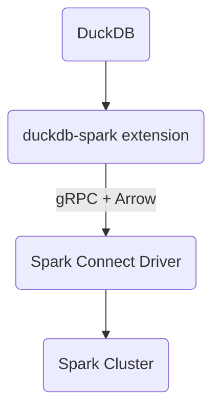
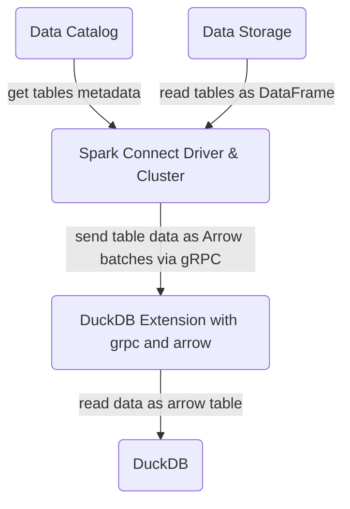
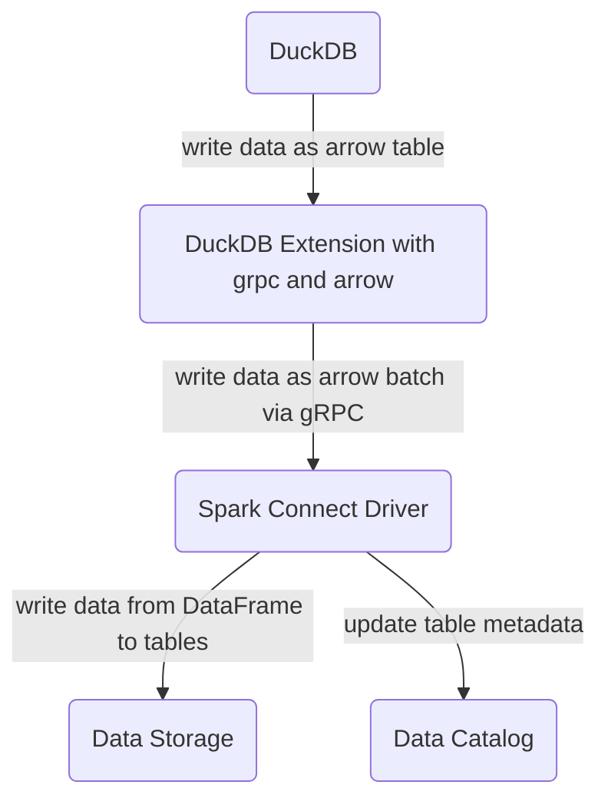

# DuckDB Spark Extension

## Introduction

`duckdb-spark` is a DuckDB extension that enables DuckDB to connect to Apache Spark via the [Spark Connect API](https://spark.apache.org/docs/latest/spark-connect-overview.html), allowing DuckDB to leverage the broader Spark ecosystem.

The vision of this project is to enable hybrid data processing systems that combine the strengths of distributed computing (scalability) with local computing (performance).

## Overall Design

### Overview

The `duckdb-spark` extension acts as a bridge between DuckDB and the Spark Connect Driver, enabling DuckDB to utilize the resources of scalable, distributed Spark clusters. It connects to a broad range of data systems (Cloudera, Databricks, etc.) and open lakehouses (Apache Iceberg, Delta Lake, Apache Hudi, Apache Paimon, etc.), allowing users to explore and analyze data without needing to manage the underlying storage or table format details.

This project is made possible by two key foundations:

1. **Spark Connect API** — built on two language-agnostic technologies: [gRPC](https://grpc.io/) and [Apache Arrow](https://arrow.apache.org/) in-memory columnar data format.
2. **DuckDB's Apache Arrow integration** — enables zero-copy data access and conversion between DuckDB's internal format and Arrow `RecordBatch`.

### Read Path

### Write Path

## Documentation

- [Extension Docs](./docs/README.md)
